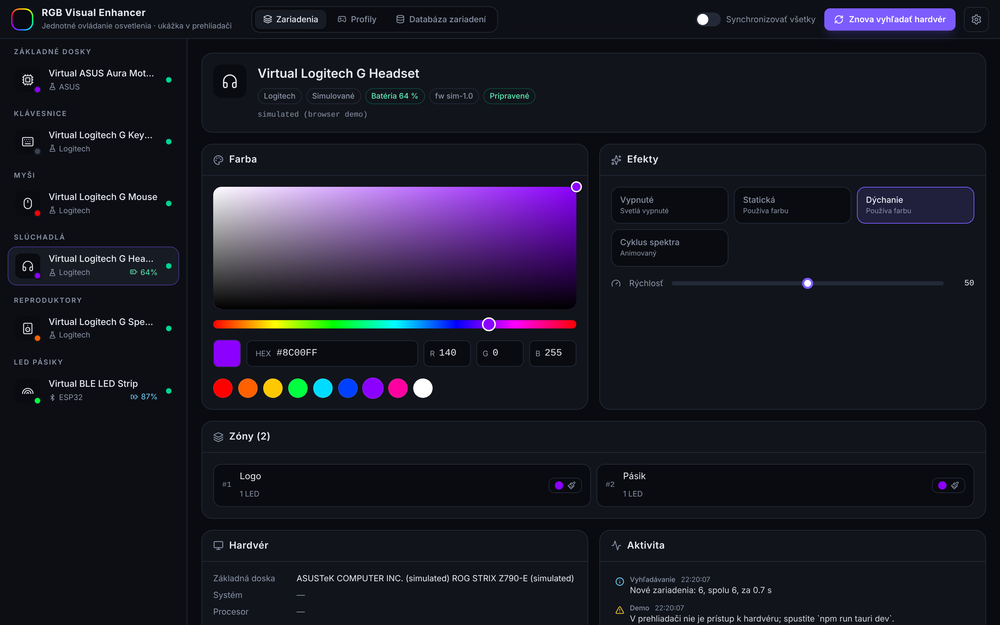
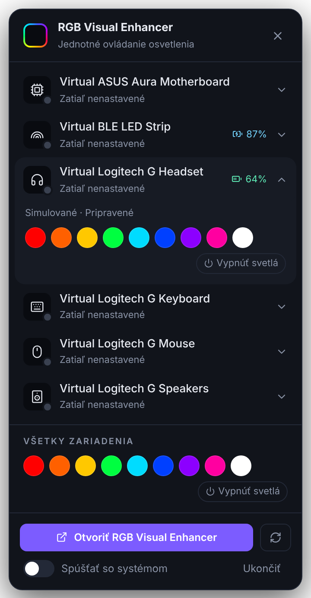
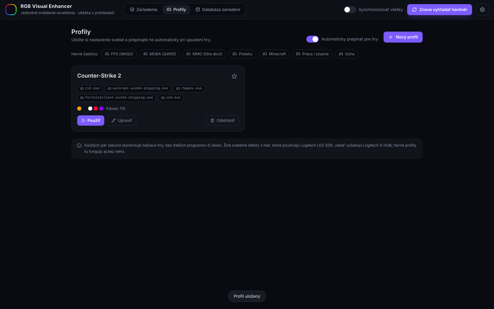
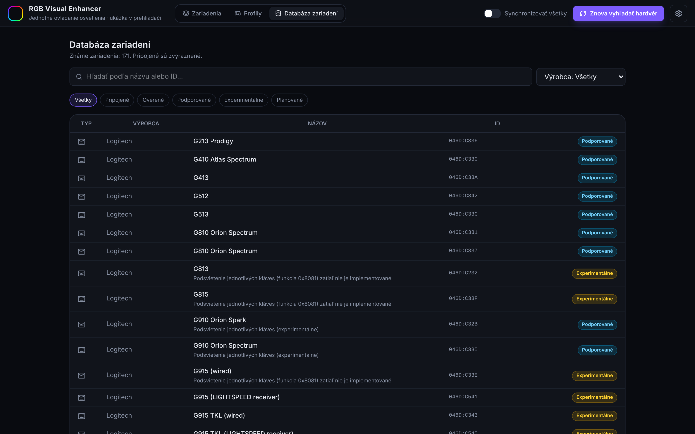
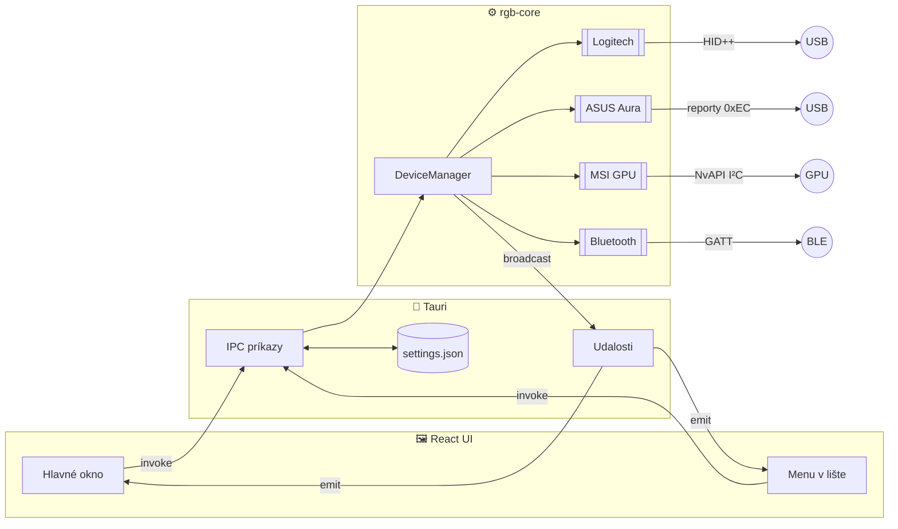

<p align="center">
  
</p>

<p align="center">
  <br>
  <b>Jedna ľahká aplikácia pre všetky RGB svetlá v počítači.</b><br>
  Žiadny Armoury Crate, žiadny G HUB, žiadne bloatware.
</p>

<p align="center">
  
  
  
  
  
  
</p>

<p align="center">
  <b>🇸🇰 Slovensky</b> · <a href="docs/README.en.md">🇬🇧 English</a>
  <br><br>
  <a href="#-ukážky">Ukážky</a> ·
  <a href="#-podporovaný-hardvér">Hardvér</a> ·
  <a href="#-inštalácia">Inštalácia</a> ·
  <a href="#-ovládanie">Ovládanie</a> ·
  <a href="#-profily-a-hry">Profily</a> ·
  <a href="#-ako-to-funguje">Architektúra</a> ·
  <a href="#-pre-vývojárov">Vývoj</a>
</p>

---

## ✨ Čo aplikácia vie

<table>
  <tr>
    <td width="50%" valign="top">
      <h3>🎨 Farby a efekty</h3>
      Výber farby, predvoľby, statická farba, dýchanie, blikanie, cyklus spektra aj dúhová vlna. Farbu môžete nastaviť pre celé zariadenie, pre jednu zónu alebo <b>synchronizovať na všetky zariadenia naraz</b>.
    </td>
    <td width="50%" valign="top">
      <h3>🔋 Stav zariadení</h3>
      Batéria bezdrôtových Logitech zariadení (aj slúchadiel G733), typ spojenia, stav a aktuálne svetlo. Údaje sa obnovujú automaticky.
    </td>
  </tr>
  <tr>
    <td valign="top">
      <h3>🧭 Systémová lišta</h3>
      Ako G HUB: zatvorenie okna nechá aplikáciu bežať v lište. Menu v lište má vizuál aplikácie a ponúka rýchle farby pre každé zariadenie. Voliteľne sa aplikácia spúšťa so systémom.
    </td>
    <td valign="top">
      <h3>⚡ Rýchla a bezpečná</h3>
      Rust jadro, každé zariadenie má vlastnú úlohu, UI nikdy nečaká na hardvér. Zápisy na zbernice (SMBus, I²C grafickej karty) sú obmedzené na presne overené adresy a registre.
    </td>
  </tr>
  <tr>
    <td valign="top">
      <h3>⌨️ Každá klávesa zvlášť</h3>
      Na klávesnici G910 nafarbíte klávesy kliknutím alebo ťahaním, vrátane G-kláves a loga. Herné šablóny FPS, MOBA, MMO, preteky, Minecraft, práca aj dúha.
    </td>
    <td valign="top">
      <h3>🎮 Profily pre hry</h3>
      Uložte si nastavenie ako profil a priraďte k nemu hry (<code>cs2.exe</code>…). Keď hru spustíte, profil sa zapne sám; po jej ukončení sa vráti predvolený.
    </td>
  </tr>
  <tr>
    <td valign="top">
      <h3>📚 Databáza zariadení</h3>
      171 známych modelov Logitech, ASUS, MSI a Bluetooth s ID a stavom podpory. Hľadanie, filtre a zvýraznenie pripojených zariadení.
    </td>
    <td valign="top">
      <h3>🪟 Moderné okno</h3>
      Bez klasickej lišty Windows: minimalizovanie, maximalizovanie a zatvorenie sú súčasťou dizajnu. Žiadne okná príkazového riadka, všetko beží v aplikácii a zapisuje sa do log súboru.
    </td>
  </tr>
  <tr>
    <td valign="top">
      <h3>🖱️ Desktopové ovládanie</h3>
      Kontextové menu pravým tlačidlom tam, kde dáva zmysel (zariadenie, zóna, klávesa, farba, log). Žiadne prehliadačové menu ani skratky.
    </td>
    <td valign="top">
      <h3>🌍 25 jazykov</h3>
      Slovenčina (predvolená), angličtina, čeština, maďarčina, nemčina, francúzština, španielčina, taliančina, portugalčina, poľština, ukrajinčina, japončina, čínština, kórejčina, arabčina (sprava doľava) a ďalšie. Jazyk zmeníte v <b>Nastaveniach</b>.
    </td>
  </tr>
</table>

## 📸 Ukážky

<p align="center">
  
</p>

<table>
  <tr>
    <th>Menu v systémovej lište</th>
    <th>Kontextové menu a nastavenia</th>
  </tr>
  <tr>
    <td align="center" valign="top" width="40%"></td>
    <td align="center" valign="top"><br><br></td>
  </tr>
</table>

<p align="center">
  
</p>

<table>
  <tr>
    <th>Profily s automatickým prepínaním</th>
    <th>Databáza zariadení</th>
  </tr>
  <tr>
    <td></td>
    <td></td>
  </tr>
</table>

<details>
<summary><b>🌍 Iné jazyky</b>: angličtina, arabčina (RTL), japončina (kliknite pre zobrazenie)</summary>
<br>

<br><br>

<br><br>

</details>

<sub>Snímky sú z ukážkového režimu s virtuálnymi zariadeniami.</sub>

## 💻 Podporovaný hardvér

| Zariadenie | Spojenie | Stav |
|---|---|---|
| **Logitech G** myši, klávesnice, reproduktory, slúchadlá (napr. G502, G910, G733) | USB / LIGHTSPEED (HID++ 2.0) | ✅ G502 overená · 🟢 G910 a G733 rozpoznané |
| **Logitech G910** jednotlivé klávesy, G-klávesy, logo | USB HID (64 B reporty) | 🧪 Experimentálne |
| **ASUS Aura** dosky s USB ovládačom (AMD 500, Intel 400 a novšie, napr. ROG STRIX B550-F) | USB HID | 🟢 Rozpoznané na reálnom PC |
| **MSI GeForce RTX 4060 GAMING X** | I²C cez NVIDIA NvAPI | 🟢 Rozpoznané na reálnom PC (len Windows) |
| **ASUS Aura** staršie dosky s ENE čipom | SMBus | 🧪 Experimentálne (Linux) |
| **Bluetooth LED pásiky**: ESP32 ([firmvér v repozitári](firmware/esp32-ble-rgb)), ELK-BLEDOM, Triones | Bluetooth LE | 🧪 Experimentálne |

Úplný zoznam 171 modelov je v aplikácii na karte **Databáza zariadení**.

> ✅ overené = farby a efekty potvrdené na skutočnom zariadení · 🟢 rozpoznané = aplikácia zariadenie na reálnom PC nájde a ovláda, potvrdenie všetkých efektov uvítame · 🧪 experimentálne = implementované podľa dokumentovaného protokolu, zatiaľ neodskúšané

<details>
<summary><b>🔍 Ako aplikácia rozpoznáva zariadenia</b></summary>

- **Logitech:** zóny (napr. G502: hlavná a logo; G733: hlavná a logo; G560: ľavý/pravý predný a zadný) hlási samo zariadenie cez HID++ `0x8070`/`0x8071`. HID kanály `0xFF00` (myši, prijímače) a `0xFF43` (klávesnice G810/G910, slúchadlá). Funkcie zariadenia zisťuje cez HID++ (`0x8070`/`0x8071` svetlá, `0x1004`/`0x1000`/`0x1001`/`0x1F20` batéria). Ak zariadenie nepozná, vypíše do logu zoznam jeho funkcií.
- **ASUS Aura USB:** ovládač `0B05:18F3/1939/19AF/1AA6/1BED`; LED a konektory číta z jeho konfiguračnej tabuľky. Každá LED na doske, každý RGB aj ARGB konektor je samostatná zóna. Ovládač nehlási, kde na doske LED sú, preto sú očíslované (LED na doske 1, 2…).
- **MSI GPU:** len karty s presnými PCI ID (`10DE:2882` + MSI `5160`/`5164`), adresa `0x68`, len dokumentované registre, pred prvým zápisom kontrolné čítanie, nikdy zápis do flash pamäte.
- **ASUS SMBus:** len adresy `0x40`, `0x4E`, `0x4F`, len na doskách ASUS a len po overení odtlačku ENE čipu. RAM sa nikdy nedotýka.

</details>

## 📦 Inštalácia

1. Stiahnite inštalátor pre Windows:
   - **MSI** (`…_x64_sk-SK.msi` alebo `…_x64_en-US.msi`): štandardný inštalátor pre Windows
   - **EXE** (`…_x64-setup.exe`): pri inštalácii si vyberiete jazyk
   - pre 32-bitový Windows sú verzie s `x86`

   Inštalátory vytvára workflow [**Windows installers**](https://github.com/bucala/RGB-Visual-Enhancer/actions/workflows/windows-installers.yml) (sekcia *Artifacts* pri poslednom behu).
2. Inštalátor nie je digitálne podpísaný, preto Windows SmartScreen zobrazí upozornenie: **Ďalšie informácie → Spustiť aj tak**.
3. **Zatvorte G HUB, Armoury Crate, MSI Center a OpenRGB.** Inak budú farby navzájom prepisovať.

<details>
<summary><b>🐧 Linux</b></summary>

Balík `.deb` nainštaluje aj udev pravidlá. Pri ručnej inštalácii:

```bash
sudo cp packaging/linux/60-rgb-visual-enhancer.rules /etc/udev/rules.d/
```

```bash
sudo udevadm control --reload-rules && sudo udevadm trigger
```

Pre ASUS cez SMBus načítajte `i2c-dev` a pridajte sa do skupiny `i2c`:

```bash
echo i2c-dev | sudo tee /etc/modules-load.d/i2c-dev.conf && sudo modprobe i2c-dev
```

```bash
sudo groupadd -f i2c && sudo usermod -aG i2c "$USER"
```

Niektoré AMD dosky potrebujú parameter jadra `acpi_enforce_resources=lax`. Bluetooth vyžaduje BlueZ a bežiacu systémovú D-Bus. Na Linuxe má lišta natívne menu, lebo AppIndicator nehlási kliknutia.

</details>

## 🎮 Ovládanie

| Kde | Akcia | Čo sa stane |
|---|---|---|
| Ikona v lište | <kbd>Ľavé tlačidlo</kbd> | Zobrazí alebo skryje hlavné okno |
| Ikona v lište | <kbd>Pravé tlačidlo</kbd> | Menu so zariadeniami, batériou a rýchlymi farbami |
| Zariadenie v zozname | <kbd>Pravé tlačidlo</kbd> | Farby, efekty, vypnutie svetiel, kopírovanie informácií |
| Zóna | <kbd>Pravé tlačidlo</kbd> | Nafarbenie zóny vybranou alebo predvolenou farbou |
| Predvolená farba | <kbd>Pravé tlačidlo</kbd> | Použiť na toto alebo na všetky zariadenia |
| Log aktivity | <kbd>Pravé tlačidlo</kbd> | Kopírovať správu alebo celý log, vymazať log |
| Klávesa G910 | <kbd>Ľavé tlačidlo</kbd> / ťahanie | Nafarbí klávesy farbou štetca |
| Klávesa G910 | <kbd>Pravé tlačidlo</kbd> | Vziať farbu klávesy, vypnúť klávesu, predvolené farby |
| Hlavička okna | ťahanie / dvojklik | Presun okna / maximalizovanie |
| Okno | <kbd>✕</kbd> alebo <kbd>–</kbd> v hlavičke | Aplikácia beží ďalej v lište |
| Menu v lište | <kbd>Esc</kbd> alebo klik mimo | Zavrie menu |

<details>
<summary><b>💡 Tipy</b></summary>

- **Synchronizovať všetky** v hlavičke pošle zmenu farby na všetky zariadenia naraz.
- Pri slúchadlách G733 sa batéria počíta z napätia, preto je pred číslom `≈`.
- Pri vypnutých slúchadlách sa batéria nezobrazí; po zapnutí sa objaví do minúty.
- **Nastavenia → Virtuálne zariadenia** pridá simulovaný hardvér na vyskúšanie.
- Ak chcete farby po štarte PC, nastavte niektorý profil ako **predvolený** (hviezdička).
- Log aplikácie nájdete v **Nastaveniach** (cesta k súboru `rgb-visual-enhancer.log`).

</details>

## 🎮 Profily a hry

1. Nafarbite klávesnicu alebo zvoľte hernú šablónu, potom **Uložiť ako profil**.
2. Do profilu pridajte hry: napíšte názov `.exe` alebo ho vyberte zo zoznamu bežiacich programov.
3. Zapnite **Automaticky prepínať pre hry**. Aplikácia každé 3 sekundy pozrie zoznam procesov cez Windows API (žiadne pomocné programy ani okná) a zapne profil hry, ktorá beží.
4. Profil s hviezdičkou je **predvolený**: použije sa pri štarte a keď nebeží žiadna hra.

> ℹ️ Hry, ktoré si samy riadia svetlá cez Logitech LED SDK (napr. efekty pri streľbe), zatiaľ vyžadujú G HUB. Herné profily tejto aplikácie fungujú aj bez neho.

## 🧩 Ako to funguje



Každé zariadenie obsluhuje vlastná úloha (actor). Príkazy pre jedno zariadenie idú v poradí. Rýchle zmeny farby (ťahanie výberu) sa spoja do jedného zápisu. Každá operácia má časový limit, takže zaseknuté zariadenie neblokuje ostatné. Podrobnosti sú v [docs/ARCHITECTURE.md](docs/ARCHITECTURE.md) (po anglicky).

## 🔧 Pre vývojárov

<details>
<summary><b>Spustenie zo zdrojového kódu</b></summary>

Potrebujete Rust (stable), Node 22+ a [systémové závislosti Tauri](https://v2.tauri.app/start/prerequisites/). Na Windows je to Visual Studio Build Tools s „Desktop development with C++“.

```bash
npm install
```

```bash
npm run tauri dev
```

Iba UI v prehliadači so simulátorom (bez Rustu a hardvéru):

```bash
npm run dev
```

</details>

<details>
<summary><b>Zostavenie inštalátorov</b></summary>

Na Windows (MSI aj EXE, 64-bit):

```powershell
npm run tauri build
```

32-bitová verzia:

```powershell
rustup target add i686-pc-windows-msvc
```

```powershell
npm run tauri build -- --target i686-pc-windows-msvc
```

Výsledky sú v `target\…\release\bundle\msi\` a `bundle\nsis\`. Na GitHube ich zostaví workflow *Windows installers* pri každom pushi. Workflow *Release* (tag `v*`) ich pripojí ku konceptu vydania.

Z Linuxu sa dá krížovo zostaviť len NSIS inštalátor (MinGW + NSIS); MSI vyžaduje Windows.

</details>

<details>
<summary><b>Testy a kontrola kódu</b></summary>

```bash
cargo test --workspace
```

```bash
cargo clippy --workspace --all-targets -- -D warnings
```

```bash
npm run check:locales && npm run build
```

Testy nikdy nepristupujú k skutočnému hardvéru: protokoly sa testujú na presné bajty, ASUS ovládač na simulovanom čipe, manažér na virtuálnych zariadeniach a IPC rozhranie cez mock runtime Tauri.

</details>

<details>
<summary><b>Pridanie nového ovládača</b></summary>

1. Implementujte `RgbController` (blokujúce I/O do `tokio::task::spawn_blocking`, ponúkajte len efekty, ktoré zariadenie naozaj vie).
2. Implementujte `DeviceDetector` (stabilné ID, preskočiť ID v `known`, problémy vracať ako varovania).
3. Zaregistrujte ho v `rgb_core::default_detectors`.

</details>

<details>
<summary><b>Štruktúra projektu</b></summary>

```
crates/rgb-core/          Rust jadro bez závislosti na UI
  src/manager.rs            DeviceManager: actor na zariadenie, udalosti, limity
  src/drivers/logitech/     HID++ 2.0 (svetlá, batéria), G910 jednotlivé klávesy
  src/database.rs           Databáza známych zariadení
  src/drivers/asus_aura*    ASUS Aura (USB, SMBus)
  src/drivers/msi_gpu/      MSI GPU cez NvAPI I²C
  src/drivers/ble/          Bluetooth LE profily
src-tauri/                Tauri: IPC, lišta, nastavenia, profily, inštalátory
src/                      React UI (25 jazykov, editor kláves, profily, databáza)
src/i18n/locales/         Preklady; kontrola: npm run check:locales
firmware/esp32-ble-rgb/   Firmvér pre vlastný ESP32 LED ovládač
docs/                     Architektúra, obrázky, anglické README
```

</details>

## 📄 Licencia

[MIT](LICENSE). Protokoly zariadení sú implementované podľa verejnej dokumentácie projektov [OpenRGB](https://gitlab.com/CalcProgrammer1/OpenRGB) a [Solaar](https://github.com/pwr-Solaar/Solaar).

<p align="center"><sub>Vytvorené s 🌈 pre všetkých, ktorí chcú RGB bez bloatwaru.</sub></p>
