<p align="center">
  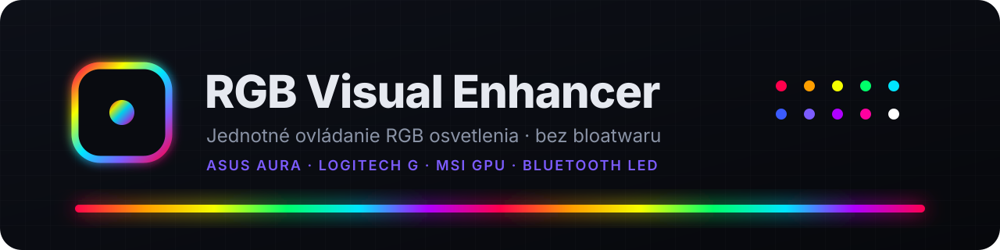
</p>

<p align="center">
  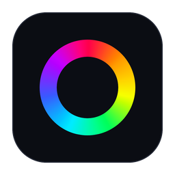<br>
  <b>One lightweight app for every RGB light in your PC.</b><br>
  No Armoury Crate, no G HUB, no bloatware.
</p>

<p align="center">
  
  
  
  
  
  
</p>

<p align="center">
  <a href="../README.md">🇸🇰 Slovensky</a> · <b>🇬🇧 English</b>
  <br><br>
  <a href="#-screenshots">Screenshots</a> ·
  <a href="#-supported-hardware">Hardware</a> ·
  <a href="#-installation">Installation</a> ·
  <a href="#-controls">Controls</a> ·
  <a href="#-profiles-and-games">Profiles</a> ·
  <a href="#-how-it-works">Architecture</a> ·
  <a href="#-for-developers">Development</a>
</p>

---

## ✨ Features

<table>
  <tr>
    <td width="50%" valign="top">
      <h3>🎨 Colours and effects</h3>
      Colour picker, presets, static, breathing, flashing, spectrum cycle and rainbow wave, per device, per zone, or <b>synced across every device at once</b>.
    </td>
    <td width="50%" valign="top">
      <h3>🔋 Device status</h3>
      Battery of wireless Logitech devices (including G733 headsets), connection type, status and current lighting, refreshed automatically.
    </td>
  </tr>
  <tr>
    <td valign="top">
      <h3>🧭 System tray</h3>
      Like G HUB: closing the window keeps the app running in the tray. The tray menu is styled like the app and offers quick colours per device. Optional start with the system.
    </td>
    <td valign="top">
      <h3>⚡ Fast and safe</h3>
      Rust core, one task per device, and the UI never waits on hardware. Bus writes (SMBus, GPU I²C) are limited to verified addresses and registers.
    </td>
  </tr>
  <tr>
    <td valign="top">
      <h3>⌨️ Every key on its own</h3>
      Paint G910 keys by clicking or dragging, including the G-keys and logo. Game templates for FPS, MOBA, MMO, racing, Minecraft, work and rainbow.
    </td>
    <td valign="top">
      <h3>🎮 Game profiles</h3>
      Save a setup as a profile and attach games (<code>cs2.exe</code>…). The profile switches on when the game starts and the default comes back when it exits.
    </td>
  </tr>
  <tr>
    <td valign="top">
      <h3>📚 Device database</h3>
      171 known Logitech, ASUS, MSI and Bluetooth models with ids and support status. Search, filters and connected devices highlighted.
    </td>
    <td valign="top">
      <h3>🪟 Modern window</h3>
      No classic Windows title bar: minimise, maximise and close are part of the design. No console windows; everything runs inside the app and goes to a log file.
    </td>
  </tr>
  <tr>
    <td valign="top">
      <h3>🖱️ Desktop-grade controls</h3>
      Right-click menus where they help (device, zone, key, colour, log) and no browser menus or shortcuts.
    </td>
    <td valign="top">
      <h3>🌍 25 languages</h3>
      Slovak (default), English, Czech, Hungarian, German, French, Spanish, Italian, Portuguese, Polish, Ukrainian, Japanese, Chinese, Korean, Arabic (right-to-left) and more. Change it in <b>Settings</b>.
    </td>
  </tr>
</table>

## 📸 Screenshots

<p align="center">
  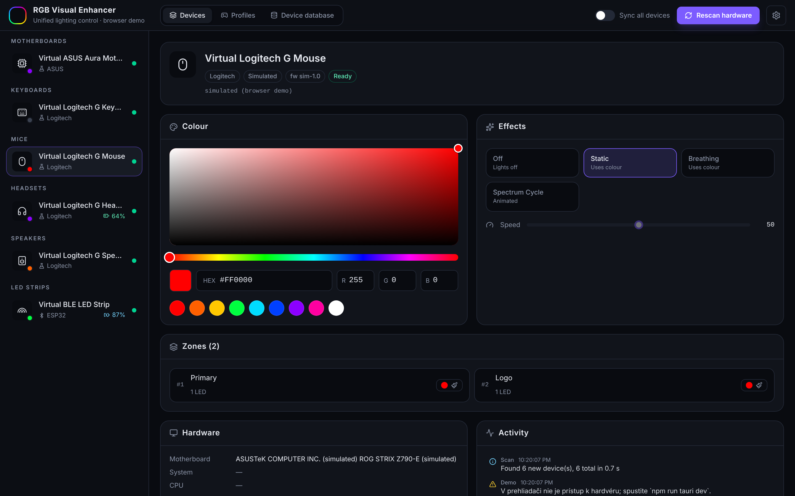
</p>

<table>
  <tr>
    <th>Tray menu</th>
    <th>Context menu and settings</th>
  </tr>
  <tr>
    <td align="center" valign="top" width="40%">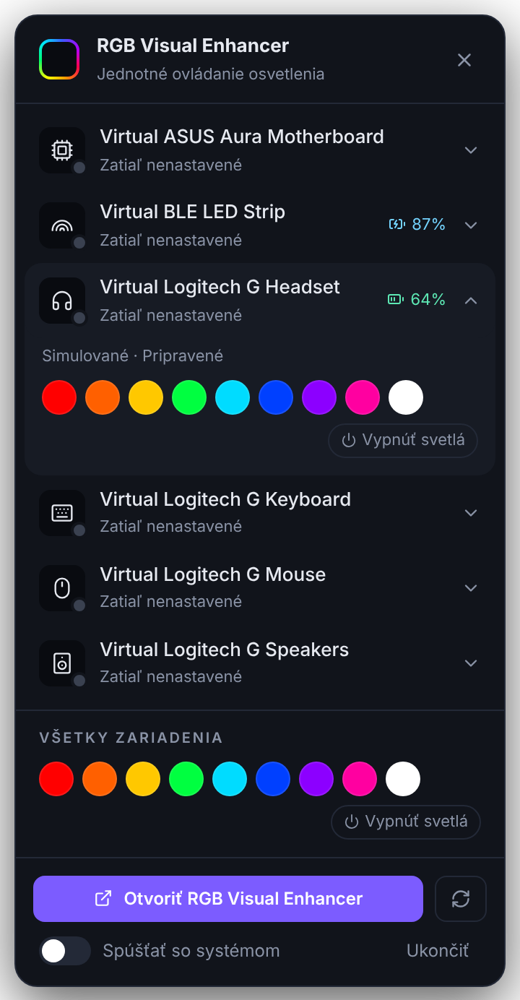</td>
    <td align="center" valign="top">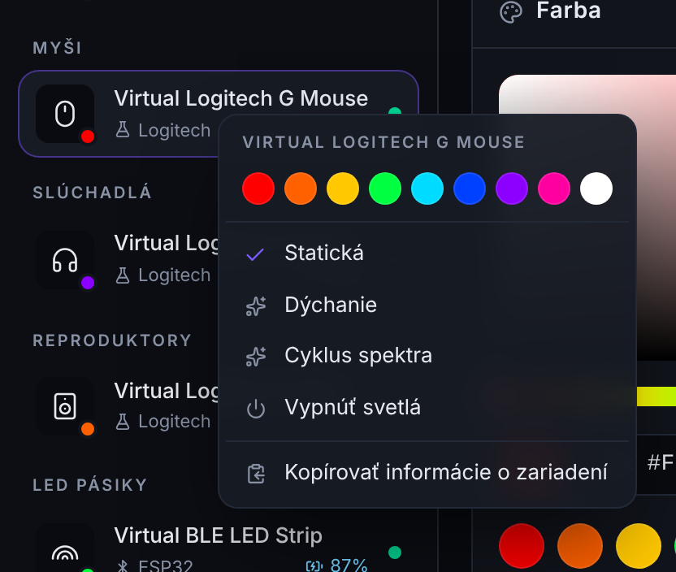<br><br>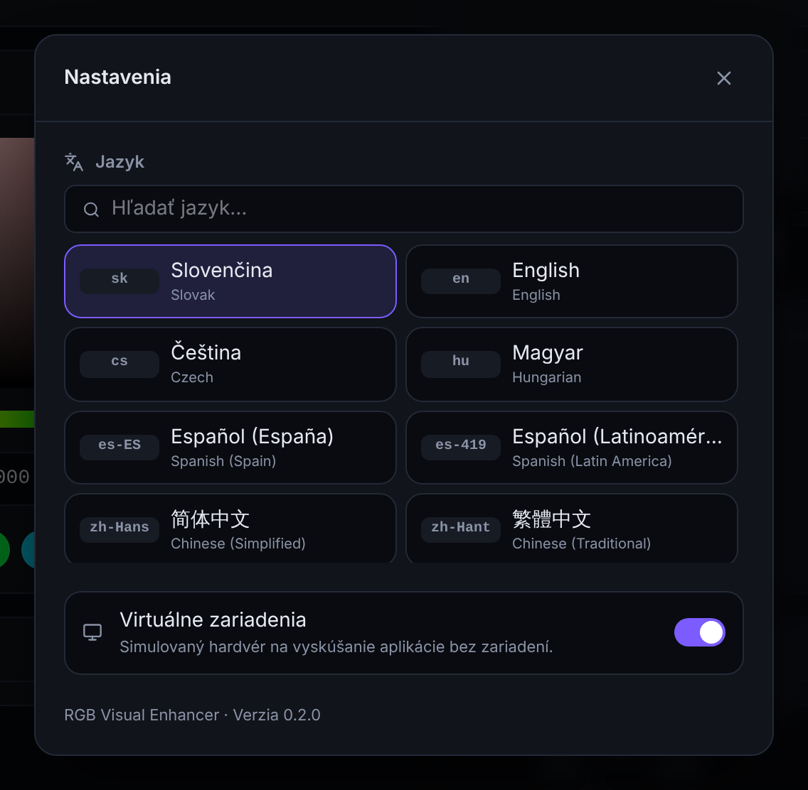</td>
  </tr>
</table>

<p align="center">
  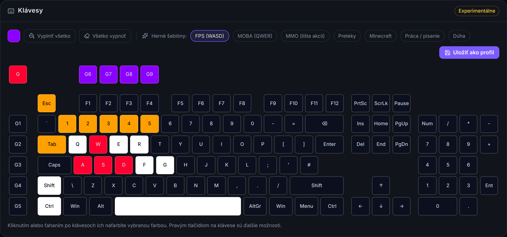
</p>

<table>
  <tr>
    <th>Profiles with automatic switching</th>
    <th>Device database</th>
  </tr>
  <tr>
    <td>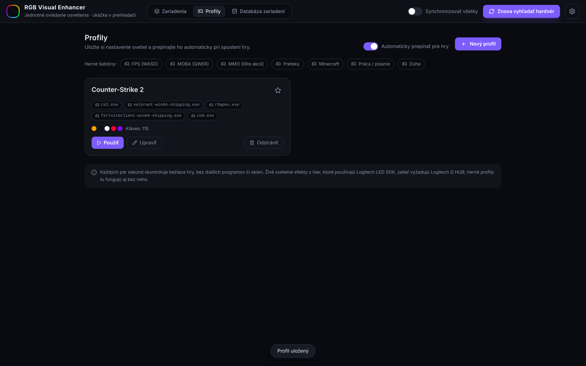</td>
    <td>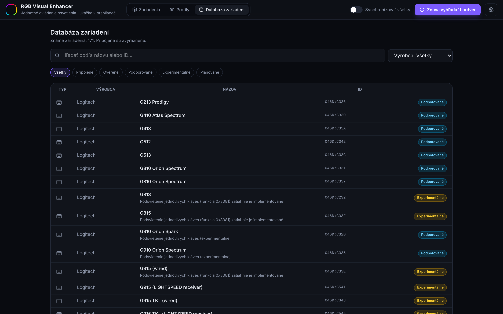</td>
  </tr>
</table>

<details>
<summary><b>🌍 Other languages</b>: Arabic (RTL), Japanese (click to show)</summary>
<br>
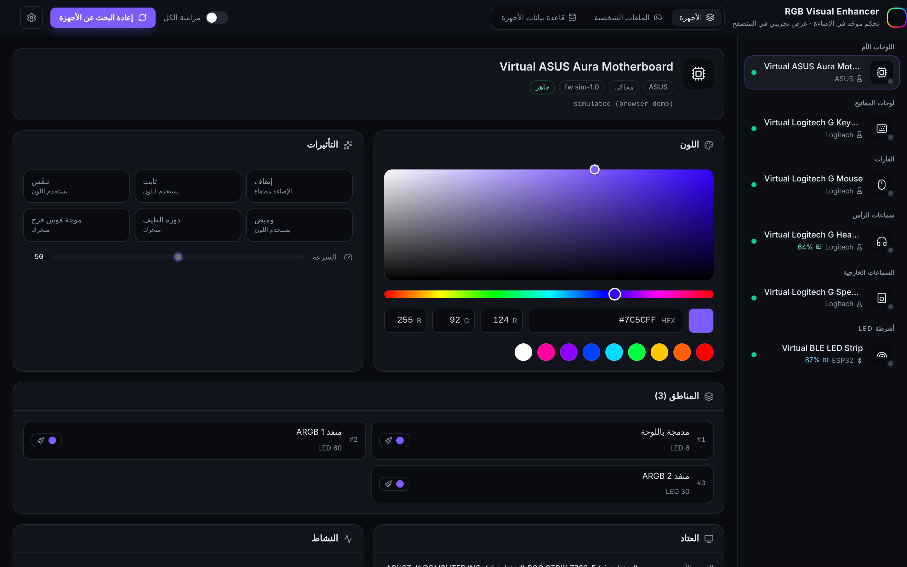
<br><br>
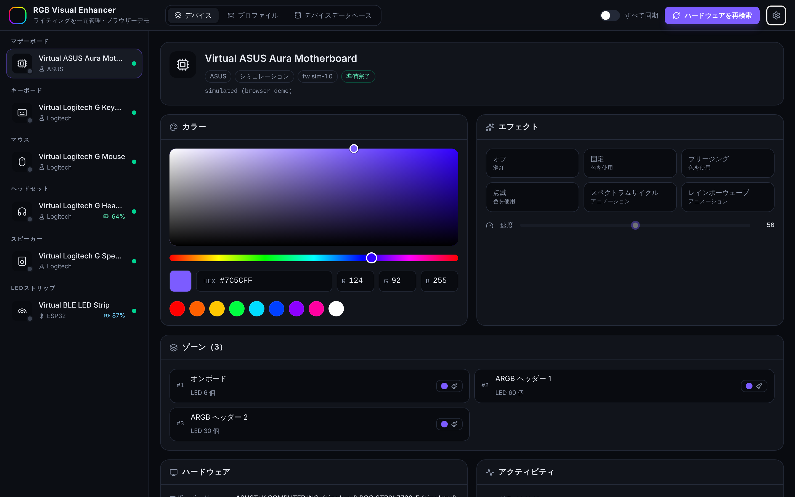
</details>

<sub>Screenshots use the demo mode with virtual devices; most are shown in Slovak, the default language.</sub>

## 💻 Supported hardware

| Device | Connection | Status |
|---|---|---|
| **Logitech G** mice, keyboards, speakers, headsets (e.g. G502, G910, G733) | USB / LIGHTSPEED (HID++ 2.0) | ✅ G502 verified · 🟢 G910 and G733 detected |
| **Logitech G910** per-key, G-keys, logo | USB HID (64-byte reports) | 🧪 Experimental |
| **ASUS Aura** boards with the USB controller (AMD 500, Intel 400 and newer, e.g. ROG STRIX B550-F) | USB HID | 🟢 Detected on a real PC |
| **MSI GeForce RTX 4060 GAMING X** | I²C via NVIDIA NvAPI | 🟢 Detected on a real PC (Windows only) |
| **ASUS Aura** older boards with the ENE chip | SMBus | 🧪 Experimental (Linux) |
| **Bluetooth LED strips**: ESP32 ([firmware included](../firmware/esp32-ble-rgb)), ELK-BLEDOM, Triones | Bluetooth LE | 🧪 Experimental |

The full list of 171 models is in the app under **Device database**.

> ✅ verified = colours and effects confirmed on real hardware · 🟢 detected = found and controlled on a real PC; confirmation of every effect welcome · 🧪 experimental = implemented from the documented protocol, not yet tried

<details>
<summary><b>🔍 How devices are detected</b></summary>

- **Logitech:** zones (e.g. G502: primary and logo; G733: primary and logo; G560: left/right front and rear) are reported by the device itself over HID++ `0x8070`/`0x8071`. HID++ on usage pages `0xFF00` (mice, receivers) and `0xFF43` (G810/G910 keyboards, headsets). Features are discovered via HID++ (`0x8070`/`0x8071` lighting, `0x1004`/`0x1000`/`0x1001`/`0x1F20` battery). Unknown devices log their feature list.
- **ASUS Aura USB:** controllers `0B05:18F3/1939/19AF/1AA6/1BED`; LEDs and headers come from the controller's config table. Every onboard LED and every RGB/ARGB header is its own zone. The controller doesn't say where each LED sits on the board, so they are numbered (Board LED 1, 2…).
- **MSI GPU:** only exact PCI ids (`10DE:2882` + MSI `5160`/`5164`), address `0x68`, documented registers only, a read before the first write, never the flash/save register.
- **ASUS SMBus:** only addresses `0x40`, `0x4E`, `0x4F`, only on ASUS boards and only after the ENE fingerprint check. Memory modules are never touched.

</details>

## 📦 Installation

1. Download a Windows installer:
   - **MSI** (`…_x64_sk-SK.msi` or `…_x64_en-US.msi`): the standard Windows installer
   - **EXE** (`…_x64-setup.exe`): lets you pick the language during setup
   - `x86` builds are for 32-bit Windows

   The [**Windows installers**](https://github.com/bucala/RGB-Visual-Enhancer/actions/workflows/windows-installers.yml) workflow produces them (see *Artifacts* on the latest run).
2. The installers are unsigned, so Windows SmartScreen shows a warning: **More info → Run anyway**.
3. **Close G HUB, Armoury Crate, MSI Center and OpenRGB**, or they will keep overriding the lighting.

<details>
<summary><b>🐧 Linux</b></summary>

The `.deb` package installs the udev rules. For a manual install:

```bash
sudo cp packaging/linux/60-rgb-visual-enhancer.rules /etc/udev/rules.d/
```

```bash
sudo udevadm control --reload-rules && sudo udevadm trigger
```

For ASUS over SMBus, load `i2c-dev` and join the `i2c` group:

```bash
echo i2c-dev | sudo tee /etc/modules-load.d/i2c-dev.conf && sudo modprobe i2c-dev
```

```bash
sudo groupadd -f i2c && sudo usermod -aG i2c "$USER"
```

Some AMD boards also need the kernel parameter `acpi_enforce_resources=lax`. Bluetooth needs BlueZ and a running system D-Bus. On Linux the tray uses a native menu, because AppIndicator doesn't report clicks.

</details>

## 🎮 Controls

| Where | Action | Result |
|---|---|---|
| Tray icon | <kbd>Left click</kbd> | Show or hide the main window |
| Tray icon | <kbd>Right click</kbd> | Menu with devices, battery and quick colours |
| Device in the list | <kbd>Right click</kbd> | Colours, effects, lights off, copy device info |
| Zone | <kbd>Right click</kbd> | Paint with the selected or a preset colour |
| Preset colour | <kbd>Right click</kbd> | Apply to this device or to all devices |
| Activity log | <kbd>Right click</kbd> | Copy message or whole log, clear log |
| G910 key | <kbd>Left click</kbd> / drag | Paints keys with the brush colour |
| G910 key | <kbd>Right click</kbd> | Pick the key colour, turn the key off, preset colours |
| Window header | drag / double click | Move the window / maximise |
| Window | <kbd>✕</kbd> or <kbd>–</kbd> in the header | Keeps running in the tray |
| Tray menu | <kbd>Esc</kbd> or click outside | Closes the menu |

<details>
<summary><b>💡 Tips</b></summary>

- **Sync all devices** in the header sends colour changes to every device.
- G733 battery is derived from voltage, hence the `≈`.
- A switched-off headset shows no battery; it appears within a minute after switching on.
- **Settings → Virtual devices** adds simulated hardware for trying things out.
- To get colours back after a reboot, mark a profile as the **default** (star).
- The app's log file path (`rgb-visual-enhancer.log`) is shown in **Settings**.

</details>

## 🎮 Profiles and games

1. Paint the keyboard or pick a game template, then **Save as profile**.
2. Add games to the profile: type the `.exe` name or pick it from the running programs.
3. Turn on **Switch automatically for games**. Every 3 seconds the app reads the process list through the Windows API (no helper programs or windows) and applies the profile of the running game.
4. The starred profile is the **default**: it is used at startup and whenever no game is running.

> ℹ️ Games that drive the lights themselves through the Logitech LED SDK (e.g. muzzle-flash effects) still need G HUB. This app's game profiles work without it.

## 🧩 How it works

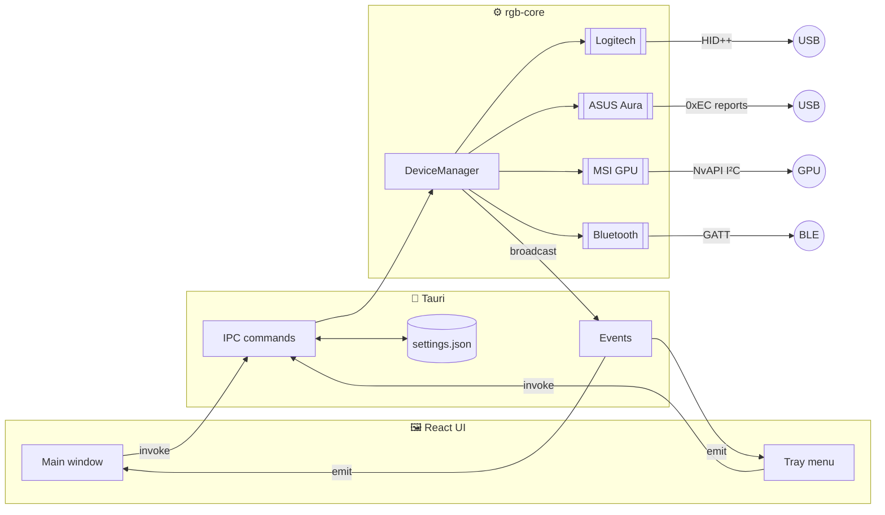

Each device is served by its own task (an actor). Commands for one device run in order, bursts of colour changes collapse into one write, and every hardware call has a timeout, so a stuck device never blocks the others. See [ARCHITECTURE.md](ARCHITECTURE.md).

## 🔧 For developers

<details>
<summary><b>Run from source</b></summary>

You need Rust (stable), Node 22+ and the [Tauri prerequisites](https://v2.tauri.app/start/prerequisites/). On Windows that means Visual Studio Build Tools with "Desktop development with C++".

```bash
npm install
```

```bash
npm run tauri dev
```

UI only, in a browser with the simulator (no Rust or hardware needed):

```bash
npm run dev
```

</details>

<details>
<summary><b>Build installers</b></summary>

On Windows (MSI and EXE, 64-bit):

```powershell
npm run tauri build
```

32-bit:

```powershell
rustup target add i686-pc-windows-msvc
```

```powershell
npm run tauri build -- --target i686-pc-windows-msvc
```

Output goes to `target\…\release\bundle\msi\` and `bundle\nsis\`. On GitHub, the *Windows installers* workflow builds them on every push, and the *Release* workflow (tag `v*`) attaches them to a draft release.

From Linux only the NSIS installer can be cross-built (MinGW + NSIS); MSI needs Windows.

</details>

<details>
<summary><b>Tests and linting</b></summary>

```bash
cargo test --workspace
```

```bash
cargo clippy --workspace --all-targets -- -D warnings
```

```bash
npm run check:locales && npm run build
```

Tests never touch real hardware: protocols are checked byte-for-byte, the ASUS driver runs against a simulated chip, the manager against virtual devices, and the IPC surface through Tauri's mock runtime.

</details>

<details>
<summary><b>Adding a driver</b></summary>

1. Implement `RgbController` (blocking I/O inside `tokio::task::spawn_blocking`; advertise only effects the device really supports).
2. Implement `DeviceDetector` (stable ids, skip ids in `known`, report problems as warnings).
3. Register it in `rgb_core::default_detectors`.

</details>

## 📄 License

[MIT](../LICENSE). Device protocols are implemented from the public documentation of [OpenRGB](https://gitlab.com/CalcProgrammer1/OpenRGB) and [Solaar](https://github.com/pwr-Solaar/Solaar).

<p align="center"><sub>Made with 🌈 for everyone who wants RGB without the bloat.</sub></p>
